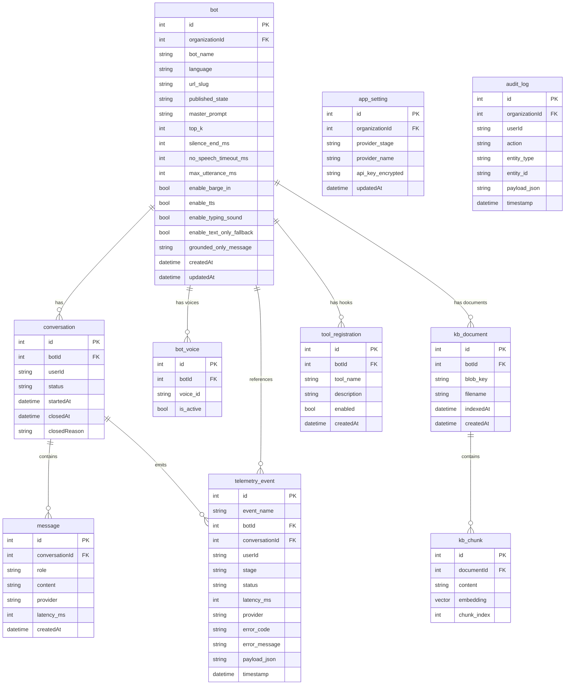
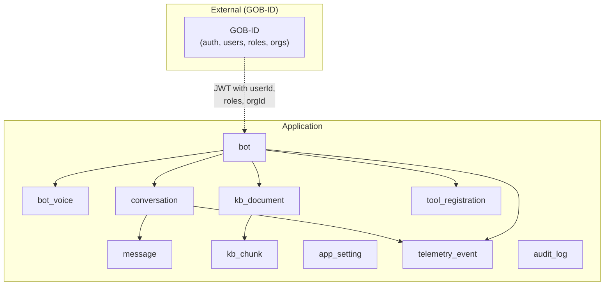
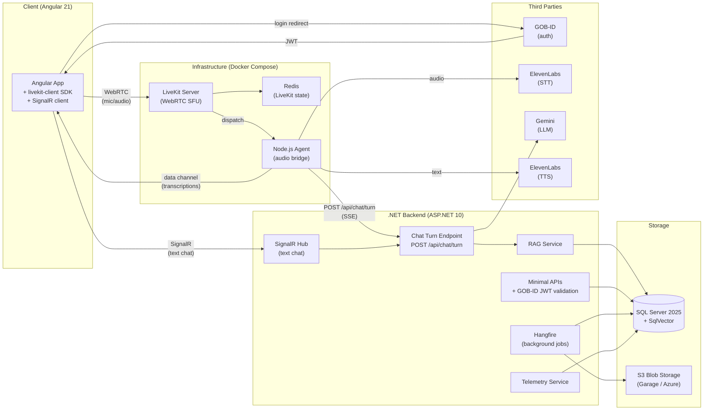
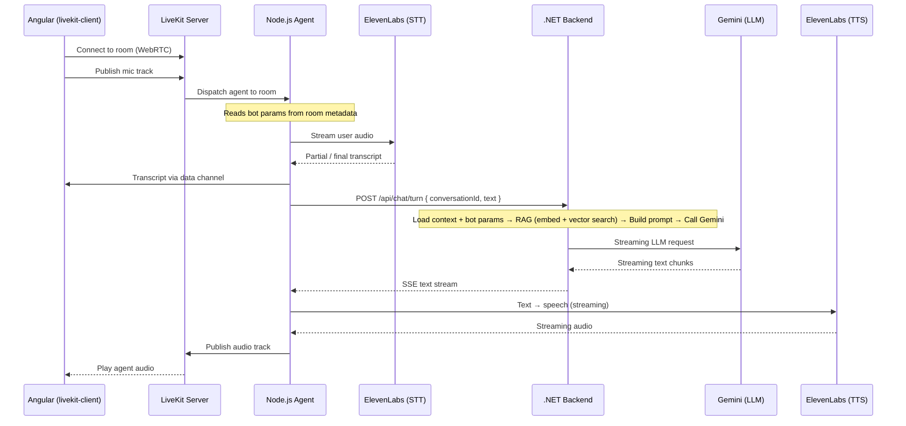
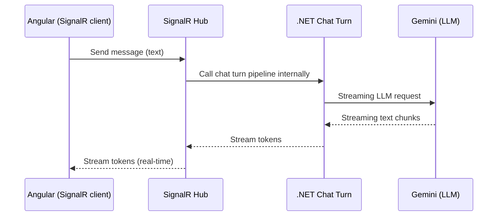
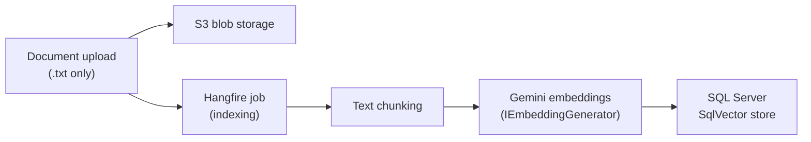
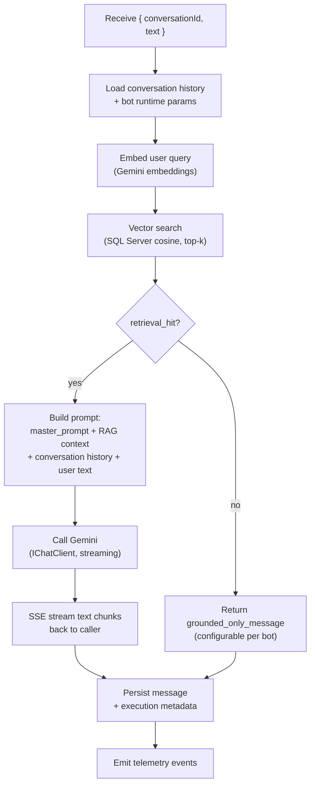

# Bot Factory — Architecture Design Document

**Version:** 2.1  
**Last updated:** March 18, 2026

---

## 1. Executive Summary

Bot Factory is a multi-tenant voice AI platform that lets organizations create, configure, and publish conversational bots. Users interact with bots via voice (WebRTC through LiveKit) and text (SignalR). Bots can be grounded in a knowledge base (RAG, grounded-only). The platform runs on ASP.NET 10 with an Angular 21 frontend, SQL Server 2025 for storage and vector search, and a LiveKit-based voice pipeline with a thin Node.js audio bridge.

Authentication, authorization, and user management are fully handled by **GOB-ID**. The application receives a JWT from GOB-ID, validates it, and reads identity, roles, and organization membership from the token claims.

This document describes the database schema, system design (including the three-process voice pipeline), third-party integrations, and technology justifications. The scope corresponds to the PRD and signed contract.

---

## 2. Database Schema

Authentication, authorization, and user/organization management are handled externally by **GOB-ID**. The application schema covers bots, chat, knowledge base, embeddings, telemetry, provider configuration, and audit logging. All tables use `organizationId` for multi-tenancy (shared schema with global query filters). Organization data itself lives in GOB-ID — the app reads the `organizationId` from the JWT.

### 2.1 Application Tables

#### Table Summary

| Table               | Purpose                                                                                                                                                                                                  |
| ------------------- | -------------------------------------------------------------------------------------------------------------------------------------------------------------------------------------------------------- |
| `bot`               | Bot definition per organization: name, language, url_slug, published_state, master_prompt (overwritten, no versioning, no variables), top_k, silence/timeout settings, toggles, grounded_only_message.   |
| `bot_voice`         | Voice catalog per bot: voice_id, is_active. Available voices come from the TTS provider configured in App Settings. One voice is marked active per bot (PRD RF-2).                                       |
| `conversation`      | One chat session: botId, userId (GOB-ID subject), status, startedAt, closedAt, closedReason. See conversation lifecycle below.                                                                           |
| `message`           | Messages in a conversation: role (user/assistant), content, provider used, latency. Final transcriptions only (partial transcripts are telemetry events, not persisted as messages).                     |
| `kb_document`       | Knowledge base file per bot (.txt only): blob_key (S3), filename, indexedAt.                                                                                                                             |
| `kb_chunk`          | Text chunks with SQL Server vector (`SqlVector`) embedding for RAG retrieval.                                                                                                                            |
| `app_setting`       | Organization-scoped provider API keys and active provider selection per stage (STT/LLM/TTS/Embedding). Encrypted at rest. Same provider configuration applies to all bots in the organization (PRD 7.2). |
| `telemetry_event`   | Events for observability per PRD RF-23. Fields: event_id, event_name, timestamp, bot_id, conversation_id, userId, stage, status, latency_ms, provider, error_code, error_message, payload_json.          |
| `tool_registration` | Architectural hook for future function call / MCP integrations (PRD Section 9). Registration only — no execution in v1.                                                                                  |
| `audit_log`         | Audit trail for sensitive config changes: bot publish/unpublish, API key updates, prompt changes (PRD data model + contract).                                                                            |

Vector search uses **SQL Server 2025 SqlVector** on `kb_chunk.embedding` for cosine-distance top-k similarity search.

#### Conversation Lifecycle

The `conversation` table tracks the full lifecycle of a chat session.

| Field          | Description                                                    |
| -------------- | -------------------------------------------------------------- |
| `status`       | Current state: `active`, `closed`                              |
| `startedAt`    | Timestamp when the conversation was created                    |
| `closedAt`     | Timestamp when the conversation was closed (null while active) |
| `closedReason` | Why the conversation ended (null while active)                 |

| closedReason   | Description                                                                            |
| -------------- | -------------------------------------------------------------------------------------- |
| `user_ended`   | The user explicitly clicked the "Cerrar" button to end the session                     |
| `user_aborted` | The user closed the browser or navigated away without ending the session               |
| `timeout`      | The user was disconnected and the system closed the session after an inactivity period |

When a conversation is closed, the system sets `status = 'closed'`, records `closedAt`, and writes the appropriate `closedReason`. A `conversation_ended` telemetry event is also emitted with the reason in `payload_json`.

### 2.2 Schema Overview

---

## 3. System Design

### 3.1 High-Level Architecture (Three Processes)

The voice pipeline requires three cooperating processes. In production all three run as containers (supports both SaaS multi-tenant and Standalone single-tenant deployment per PRD 6.2); in development they run via Docker Compose.

| Process            | Role                                                                                                                                                                                                                                            |
| ------------------ | ----------------------------------------------------------------------------------------------------------------------------------------------------------------------------------------------------------------------------------------------- |
| **LiveKit Server** | Self-hosted WebRTC SFU. Routes audio between browser and agent. Stores state in Redis.                                                                                                                                                          |
| **Node.js Agent**  | Thin audio bridge (~50 lines). Subscribes to user mic, runs ElevenLabs STT, sends transcript to .NET backend, pipes response through ElevenLabs TTS, publishes audio back. No LLM, no RAG, no business logic.                                   |
| **.NET Backend**   | All orchestration: JWT validation (GOB-ID), chat turn pipeline (conversation context → RAG → Gemini → streaming response), persistence, background jobs (Hangfire), telemetry, audit logging. Exposes REST APIs, SignalR hub, and SSE endpoint. |

### 3.2 Voice Pipeline Flow (PRD RF-17)

Barge-in (PRD RF-13): if the user speaks during TTS playback, the agent cuts audio, emits a `barge_in` event, and takes the user's turn.

### 3.3 Text Chat Flow (PRD RF-18)

For text-only interaction (no voice), the browser connects directly to the SignalR hub. The same chat turn pipeline is used — one pipeline, two entry points. Same as voice but replacing STT with direct text input.

### 3.4 Third-Party Integration Summary

| Integration             | Protocol / SDK                                                  | Data flow                                               |
| ----------------------- | --------------------------------------------------------------- | ------------------------------------------------------- |
| **GOB-ID**              | OIDC / JWT                                                      | Login redirect → JWT with userId, roles, organizationId |
| **ElevenLabs** (STT)    | WebSocket from Node.js agent (ElevenLabs plugin)                | Streaming audio in → partial/final transcript out       |
| **Gemini** (LLM)        | HTTP streaming via `IChatClient` (Microsoft.Extensions.AI)      | Messages + RAG context in → streaming text chunks out   |
| **Gemini** (Embeddings) | HTTP via `IEmbeddingGenerator` (Microsoft.Extensions.AI)        | Text chunks / queries in → vector embeddings out        |
| **ElevenLabs** (TTS)    | WebSocket from Node.js agent (ElevenLabs plugin)                | Text in → streaming audio out                           |
| **LiveKit Server**      | Self-hosted (Docker), `livekit-client` JS SDK, `.NET` token SDK | WebRTC audio transport + data channels                  |

Providers (STT, LLM, TTS) are configured once at the organization level via **App Settings** and apply to all bots in that organization. Bot-specific params (voice_id, VAD settings) are passed to the agent via LiveKit **room metadata**. LLM/RAG params (master_prompt, top_k, grounded_only_message) stay in the .NET backend — the agent never sees them.

### 3.5 Knowledge Base Ingestion (PRD RF-5, RF-6)

### 3.6 Chat Turn Pipeline (PRD RF-17, RF-7, RF-8)

The `POST /api/chat/turn` endpoint is the core orchestration point. It receives `{ conversationId, text }` and returns an SSE stream of plain text chunks. No retries to providers (PRD RF-19): if STT/LLM/TTS fails, a user-facing error is returned and a failure event is emitted.

### 3.7 "Probar" Mode (PRD RF-21)

Before publishing, admins can test bots via "Probar" mode in the portal. The admin chat UI shows an additional debug panel (visible to admin roles only) displaying:

- Transcription (partial and final)
- Top-k retrieved chunks (document IDs/titles and fragments)
- LLM response
- Latencies per stage (STT → embedding → retrieval → LLM → TTS)

This data comes from telemetry events streamed in real-time via SignalR.

### 3.8 Function Call / MCP Hook (PRD Section 9)

In v1, only the **architectural hook** is implemented — no actual tool execution:

- `tool_registration` table: register available tools per bot (name, description, enabled flag).
- Permission model: admins control which tools are enabled per bot.
- Tool call events: if the LLM produces a tool call, it is logged as a telemetry event (not executed).

Actual execution of function calls and MCP integrations is deferred to a future phase.

---

## 4. Technology & Third-Party Justification

### 4.1 Core Stack

| Technology                   | Role                                          | Justification                                                                                                                                                                                               |
| ---------------------------- | --------------------------------------------- | ----------------------------------------------------------------------------------------------------------------------------------------------------------------------------------------------------------- |
| **ASP.NET 10**               | Backend API (Minimal APIs, EF Core)           | Mature, high-performance, strong typing; built-in DI and middleware; first-class support for streaming (SSE) and SignalR.                                                                                   |
| **Angular 21**               | Frontend SPA (standalone components, signals) | Enterprise-grade framework; strong routing, DI, and form handling; good fit for admin-heavy UIs; signal-based reactivity for real-time chat.                                                                |
| **Tailwind CSS 4 + Core-UI** | Styling + component library                   | Utility-first CSS with the Core-UI component library supplied by the client (contract requirement).                                                                                                         |
| **SQL Server 2025**          | Primary database + vector storage             | ACID, mature, strong tooling; new `SqlVector` type eliminates the need for a separate vector DB; single database for all data (config, conversations, events, embeddings).                                  |
| **EF Core**                  | ORM + migrations                              | Type-safe schema, LINQ queries, migration tooling; integrates with SQL Server vector types; well-supported in .NET ecosystem.                                                                               |
| **GOB-ID**                   | Authentication + authorization                | External OIDC identity provider. Handles login (admins + public users via Google/Microsoft), user management, role assignment, and organization membership. The app validates GOB-ID JWTs and reads claims. |
| **LiveKit**                  | WebRTC SFU (self-hosted)                      | Open-source, self-hosted WebRTC server; handles audio routing between browser and agent; agent framework with STT/TTS plugins; data channels for metadata. Satisfies PRD RF-15 (WebRTC, Opus).              |
| **Redis**                    | LiveKit state store                           | Required by LiveKit Server for room/participant state; lightweight, fast.                                                                                                                                   |
| **SignalR**                  | Text chat streaming + admin events            | Built into ASP.NET; real-time bidirectional communication; used for text chat and admin event streaming ("Probar" mode).                                                                                    |
| **Hangfire**                 | Background jobs                               | Reliable job queue with SQL Server storage; dashboard for monitoring; retry policies; good fit for KB indexing jobs.                                                                                        |
| **Docker Compose**           | Local development + Standalone deployment     | Runs SQL Server + Redis + LiveKit Server + Node.js Agent + Garage S3 in one command; also serves as the Standalone deployment mode (PRD 6.2). Configurable via environment variables / secret manager.      |
| **Azure DevOps**             | CI/CD                                         | Pipeline-as-code; integrates with Azure deployment targets; fits organizational tooling.                                                                                                                    |

### 4.2 Third-Party Services

| Service        | Use case                         | Justification                                                                                                                                                                                                                |
| -------------- | -------------------------------- | ---------------------------------------------------------------------------------------------------------------------------------------------------------------------------------------------------------------------------- |
| **ElevenLabs** | Speech-to-text + Text-to-speech  | STT and TTS from the same provider; high accuracy for real-time streaming; low latency; high-quality natural voices; voice catalog for voice selection per bot; native LiveKit agent plugin. Single API key for both stages. |
| **Gemini**     | LLM for bot replies + embeddings | Strong quality/cost ratio; streaming support; accessible via `Microsoft.Extensions.AI` (`IChatClient` / `IEmbeddingGenerator`) for clean abstraction; embedding and chat from the same provider simplifies key management.   |

In v1, each stage (STT, LLM, TTS, Embeddings) uses one provider configured at the organization level via App Settings. The provider can be changed without redeploying the frontend (PRD acceptance criteria).

### 4.3 Supporting Choices

| Item                             | Justification                                                                                                                                                                                                                                       |
| -------------------------------- | --------------------------------------------------------------------------------------------------------------------------------------------------------------------------------------------------------------------------------------------------- |
| **S3-compatible blob storage**   | Offload document binaries from the DB; Garage (Docker) for local dev, Azure Blob Storage in production; standard S3 API for portability.                                                                                                            |
| **Shared-schema multi-tenancy**  | All tables include `organizationId` with EF Core global query filters; simpler than schema-per-tenant at this scale; enforces isolation at the query level. Supports both SaaS and Standalone modes (PRD 6.2).                                      |
| **Node.js agent as thin bridge** | Keeps the agent deliberately simple (~50 LOC). All business logic (LLM, RAG, persistence) stays in .NET. The agent only handles audio I/O via ElevenLabs (STT + TTS), which makes it easy to maintain and avoids duplicating logic across runtimes. |
| **Single chat turn endpoint**    | `POST /api/chat/turn` serves both voice (via agent) and text (via SignalR). One pipeline, two entry points — avoids divergent logic and simplifies testing (PRD RF-17/RF-18).                                                                       |
| **Telemetry events table**       | Structured events (latency, provider, stage, errors) support observability and "Probar" admin debug mode (PRD RF-23); no external telemetry service needed at this stage.                                                                           |

---

## 5. Deployment Modes (PRD 6.2)

| Mode           | Description                                                                                                                        |
| -------------- | ---------------------------------------------------------------------------------------------------------------------------------- |
| **SaaS**       | Multi-tenant with logical isolation by `organizationId`. Shared infrastructure.                                                    |
| **Standalone** | Single-tenant deployment in third-party infrastructure via containers. Configuration via environment variables and secret manager. |

Both modes use the same codebase and container images. A recommended backup/restore mechanism for both the relational DB and vector data must be documented for Standalone deployments (PRD 6.3). Deployment documentation is a contract deliverable.

---

## 6. Security & Multi-Tenancy

- **Authentication:** Fully handled by GOB-ID (OIDC). Admin and public users authenticate through GOB-ID (which itself supports Google/Microsoft OAuth for public users). The app receives a JWT containing userId, roles, and organization membership. Admin JWT is securely stored in the browser (PRD 3.1).
- **Authorization:** Roles and permissions are defined and assigned in GOB-ID. The app reads roles from the JWT claims and enforces access control. The backend validates the JWT on every protected endpoint and checks role-based permissions. Angular uses route guards based on JWT claims.
- **Isolation:** All tables include `organizationId`. EF Core global query filters ensure queries are always scoped to the active organization.
- **TLS:** All traffic encrypted in transit (PRD 6.4).
- **Secrets:** Provider API keys stored encrypted in `app_setting` (organization-scoped). Keys never sent to the client. Bot voice params (voice_id, VAD settings) sent to the agent via LiveKit room metadata — no API keys in metadata.
- **Visitor access:** Unauthenticated visitors (P0) can see the bot landing page but cannot interact. GOB-ID login is required to start a conversation (PRD RF-11).
- **No retries:** If a provider call fails (STT/LLM/TTS), the error is surfaced to the user and logged as an event. No automatic retries (PRD RF-19).
- **Audit:** Sensitive configuration changes (bot publish/unpublish, API key updates, prompt changes) are recorded in `audit_log`.

---

## 7. Predefined Roles (PRD 3.2, 3.3)

Roles are defined and assigned in GOB-ID. The application reads role claims from the JWT and enforces the following permissions:

| Code | Name                       | GOB-ID Role            | Permissions                                                                                                              |
| ---- | -------------------------- | ---------------------- | ------------------------------------------------------------------------------------------------------------------------ |
| R1   | Platform Super Admin       | Administrador Maestro  | `superadmin, bot:admin, bot:read, bot:update, bot:delete, bot:publish, kb:update, kb:delete, conversation:read, telemetry:read, audit:read, bot:chat` |
| R2   | Organization Admin         | Administrador          | `bot:admin, bot:read, bot:update, bot:delete, bot:publish, kb:update, kb:delete, conversation:read, telemetry:read, audit:read, bot:chat` |
| R3   | Bot Manager                | Creador de Bots        | `bot:read, bot:update, bot:publish, conversation:read, telemetry:read, bot:chat`                                         |
| R4   | KB Editor                  | Editor de Conocimiento | `bot:read, kb:update, kb:delete, bot:chat`                                                                               |
| R5   | Analyst                    | Analista               | `bot:read, conversation:read, telemetry:read, bot:chat`                                                                  |
| R6   | Auditor                    | Auditor                | `bot:read, conversation:read, audit:read, bot:chat`                                                                      |
| P1   | Authenticated Public User  | Usuario Público        | `bot:chat`                                                                                                               |
| P0   | Visitor                    | —                      | None — can see landing + login CTA, cannot interact                                                                      |

---

## 8. Telemetry Events (PRD RF-23)

### Required Events (must implement)

conversation_started, stt_completed, retrieval_hit, llm_error, tts_first_audio, retrieval_miss, barge_in, network_degraded, kb_index_completed, bot_published, prompt_updated, api_key_updated

### Recommended Events (implement where feasible)

user_authenticated, conversation_ended, stt_failed, tts_failed, llm_started, llm_first_token, llm_completed, tts_started, tts_completed, fallback_text_only, kb_index_started, kb_index_failed, bot_unpublished

### Latency Metrics (PRD 6.1)

Measured at p50 and p95:

| Metric                           | Description                                       |
| -------------------------------- | ------------------------------------------------- |
| time_to_first_partial_transcript | User speaks → first partial STT result            |
| time_to_final_transcript         | User speaks → final STT result                    |
| time_to_first_token              | Final transcript → first LLM token                |
| time_to_first_audio              | Final transcript → first TTS audio playback       |
| end_to_end_turn_time             | User finishes speaking → bot audio starts playing |

Thresholds (ms) are defined as operational configuration per deployment (PRD 6.1).

---

## 9. Resolved Decisions

| Question                       | Decision                                                                                                                           |
| ------------------------------ | ---------------------------------------------------------------------------------------------------------------------------------- |
| Authentication & authorization | Fully handled by GOB-ID. The app validates JWTs and reads claims (userId, roles, organizationId). No internal auth implementation. |
| API key management             | Configured per provider in app_settings (organization-scoped). Same provider per stage for all bots in an organization.            |
| Voice pipeline                 | LiveKit with Node.js voice agent sidecar (thin audio bridge).                                                                      |
| Language support               | Spanish only.                                                                                                                      |
| User access                    | Users must authenticate via GOB-ID to interact; visitors can see landing.                                                          |
| Blob storage                   | S3-compatible (Garage in dev, Azure Blob in prod).                                                                                 |
| *Text chat*                    | *SignalR hub, calls same chat turn pipeline as voice. No STT/TTS.*                                                                 |
| Conversation close             | Tracked via status + closedReason fields. Reasons: user_ended, user_aborted, timeout.                                              |

---

## 10. Next Phase (out of current PRD/Contract scope)

The following items are **not included in the current scope** but are noted for future phases. Some originate from stakeholder feedback on the initial design document.

### 10.1 Function Call / MCP Execution

PRD Section 9 defines the architectural hook only for v1. Actual tool execution (connecting to external APIs, running MCP server calls, returning tool results to the LLM) is deferred.

### 10.2 Per-Bot Provider Swapping

Allow each bot to override the organization-level STT, LLM, or TTS provider with a different one. v1 uses one provider per stage across all bots in an organization.

### 10.3 Provider / Model CRUD Catalogs

Stakeholder feedback: create a CRUD for LLM models, embedding models, voice models, and STT providers that feeds dropdown selectors per bot. Current v1 uses configuration-based provider selection. Full catalog management is deferred.

### 10.4 Rate Limiting, Quotas & Consumption Tracking

Stakeholder feedback:

- Rate limiting per user/IP for public endpoints.
- Limits per organization for expensive operations.
- Quotas per bot/organization for STT, LLM, TTS, and embedding consumption.
- Track consumption per interaction (tokens in/out, audio seconds, embeddings created).
- Max concurrent requests per bot.
- KB document size limits.

No billing module required, but consumption tracking is deferred.

### 10.5 Conversation Event Stream (turn_event entity)

Stakeholder feedback: add a `conversation_event` or `turn_event` entity to capture fine-grained events per turn — partial transcripts, interruptions, segment timestamps, intermediate streaming states. v1 persists final transcriptions as messages and captures key moments as telemetry events; the granular event stream model is deferred.

### 10.6 Secrets Management Migration

Stakeholder feedback: API keys stored in `app_setting` are an acknowledged MVP concession. Future phases should migrate keys to a dedicated secrets management mechanism (e.g. Azure Key Vault) separate from functional bot configuration.

### 10.7 Correlation IDs

Stakeholder feedback: add a correlation ID per request and per conversation to enable end-to-end tracing across STT → LLM → TTS pipeline stages. Deferred to a future observability enhancement.

---

## 11. Document History

| Version | Date           | Changes                                                                                                                                                                                                                                                                                                                            |
| ------- | -------------- | ---------------------------------------------------------------------------------------------------------------------------------------------------------------------------------------------------------------------------------------------------------------------------------------------------------------------------------- |
| 1.0     | March 10, 2026 | Initial architecture (React Router, PostgreSQL, pgvector, Better Auth, OpenAI).                                                                                                                                                                                                                                                    |
| 2.0     | March 17, 2026 | Full rewrite: ASP.NET 10 + Angular 21 + SQL Server 2025 + LiveKit + Gemini. Aligned to PRD/Contract scope.                                                                                                                                                                                                                         |
| 2.1     | March 18, 2026 | Renamed tenant → organization (GOB-ID alignment). Removed ASP.NET Identity — auth/authz fully delegated to GOB-ID. Added conversation lifecycle fields (status, closedAt, closedReason). Removed organization table (GOB-ID manages orgs). Replaced Deepgram with ElevenLabs for STT. Removed organizationId from telemetry_event. |

