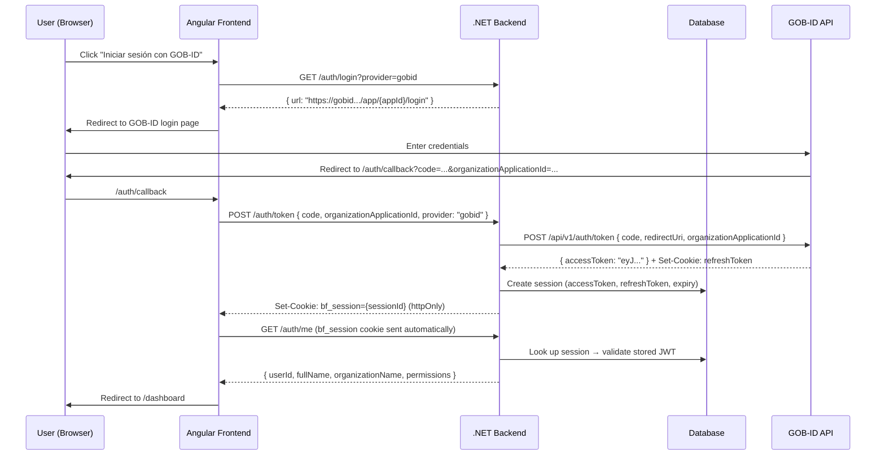
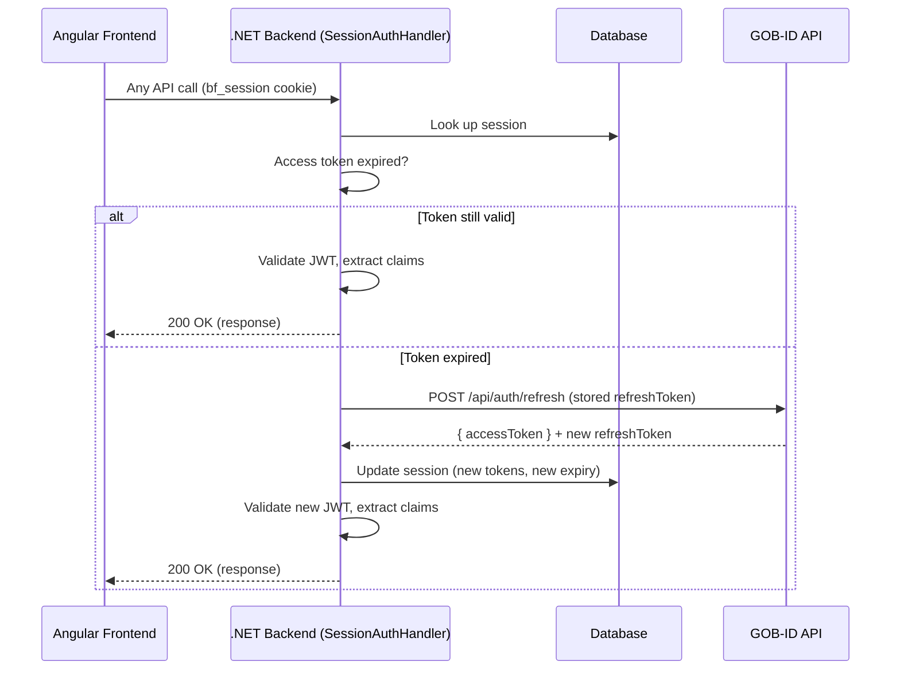
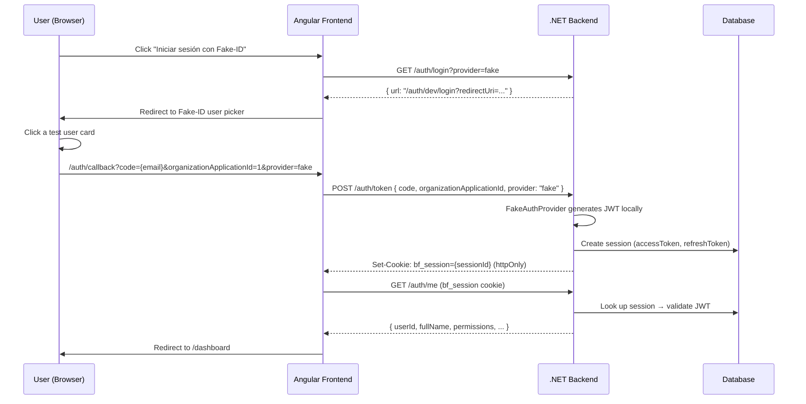

# Authentication Flow

**Version:** 1.0
**Last updated:** March 28, 2026

---

## Overview

Bot Factory delegates authentication to **GOB-ID**, the centralized government identity provider. In development, a **Fake-ID** provider mimics the same flow with seeded test users. Both providers implement the same `IAuthProvider` interface and produce JWTs with identical claim structures.

Authentication uses **server-side sessions**: the browser only receives an opaque session cookie (`bf_session`). Access tokens and refresh tokens are stored in the database, never exposed to the frontend.

Both providers are accessed through a single endpoint: `GET /auth/login?provider=gobid|fake` (gobid is default).

---

## Flow Diagram

---

## Server-Side Sessions

All tokens are stored server-side in the `Sessions` table. The browser only holds an opaque session ID cookie.

| What               | Where                              | Browser access           |
| ------------------ | ---------------------------------- | ------------------------ |
| Access token (JWT) | Database (`Sessions.AccessToken`)  | None                     |
| Refresh token      | Database (`Sessions.RefreshToken`) | None                     |
| Session ID         | `bf_session` httpOnly cookie       | Cookie jar only (not JS) |

### Session table schema

| Column         | Type     | Description                                    |
| -------------- | -------- | ---------------------------------------------- |
| `Id`           | GUID     | Primary key, used as `bf_session` cookie value |
| `AccessToken`  | string   | GOB-ID JWT stored server-side                  |
| `RefreshToken` | string   | GOB-ID refresh token stored server-side        |
| `AuthProvider` | string   | `"gobid"` or `"fake"`                          |
| `ExpiresAt`    | DateTime | When the access token expires                  |
| `CreatedAt`    | DateTime | Session creation time                          |

---

## Token Refresh (transparent, server-side)

The frontend never handles token refresh — `SessionAuthHandler` does it transparently before the request reaches the endpoint.

---

## JWT Validation (dual provider)

The backend accepts JWTs from two issuers. Both are configured at startup in `Program.cs`:

|                 | GOB-ID                            | Fake-ID (dev only)     |
| --------------- | --------------------------------- | ---------------------- |
| **Issuer**      | `https://wa-vuc-dev-gobidapi-...` | `bot-factory-dev`      |
| **Audience**    | `gobid-users`                     | `bot-factory`          |
| **Signing Key** | App Secret (Base64URL, from env)  | Dev key (UTF-8 string) |
| **Algorithm**   | HS256                             | HS256                  |

.NET tries each key in `IssuerSigningKeys` until one validates. `MapInboundClaims = false` preserves original claim names (no Microsoft URI remapping).

---

## JWT Claims (from GOB-ID)

| Claim                         | Type        | Description                                           |
| ----------------------------- | ----------- | ----------------------------------------------------- |
| `sub`                         | UUID        | User ID in GOB-ID                                     |
| `person_id`                   | UUID        | Personnel profile ID                                  |
| `application_id`              | UUID        | App ID in GOB-ID                                      |
| `organization_application_id` | string      | Org-App relationship ID (used only in token exchange) |
| `organization_id`             | string      | Organization ID (used for tenant isolation)           |
| `organization_name`           | string      | Organization name                                     |
| `organization_acronym`        | string      | Org acronym (e.g. "DEMO")                           |
| `person_full_name`            | string      | User's full name                                      |
| `permissions`                 | JSON string | Array of permission strings                           |

> **Note:** GOB-ID docs originally said `full_name` but the actual claim is `person_full_name`. This has been corrected in their docs.

---

## Claim Extraction

`TenantResolutionMiddleware` reads claims from the validated JWT and populates `TenantContext`:

| TenantContext field | JWT claim                                     |
| ------------------- | --------------------------------------------- |
| `UserId`            | `sub`                                         |
| `FullName`          | `person_full_name`                            |
| `OrganizationId`    | `organization_id`                             |
| `OrganizationName`  | `organization_name`                           |
| `Permissions`       | `permissions` (deserialized from JSON string) |

---

## Redirect URI

The `redirectUri` sent to GOB-ID in the token exchange must match exactly what GOB-ID has registered.

| Environment | Redirect URI                          |
| ----------- | ------------------------------------- |
| Local dev   | `http://localhost:4200/auth/callback` |
| Production  | TBD (pending Azure deploy URL)        |

---

## Fake-ID Flow (dev only)

### Dev token shortcut (for tests)

`POST /auth/dev/token { email?, organizationApplicationId? }` creates a session directly without the redirect flow. Used by integration tests to authenticate quickly.

### Seeded test users

| Email                   | Role                   | Key permissions                             |
| ----------------------- | ---------------------- | ------------------------------------------- |
| `superadmin@example.com` | Super Administrador    | All permissions                             |
| `admin@example.com`      | Administrador          | All except superadmin                       |
| `botcreator@example.com` | Creador de Bots        | bot:read, bot:update, bot:publish           |
| `kbeditor@example.com`   | Editor de Conocimiento | bot:read, kb:update, kb:delete              |
| `analyst@example.com`    | Analista               | bot:read, conversation:read, telemetry:read |
| `auditor@example.com`    | Auditor                | bot:read, conversation:read, audit:read     |
| `public@example.com`     | Usuario Publico        | bot:chat only                               |

---

## Environment Variables

### Backend (.env)

| Variable                     | Description                      | Example                                    |
| ---------------------------- | -------------------------------- | ------------------------------------------ |
| `Auth__GobId__ApiUrl`        | GOB-ID API base URL              | `https://wa-vuc-dev-gobidapi-...`          |
| `Auth__GobId__ApplicationId` | App ID registered in GOB-ID      | `b6e1bdf4-6128-f111-b7f2-...`              |
| `Auth__GobId__AppSecret`     | HS256 signing secret (Base64URL) | _(from GOB-ID team)_                       |
| `Auth__GobId__Authority`     | JWT issuer URL                   | Same as ApiUrl                             |
| `Auth__GobId__Audience`      | JWT audience                     | `gobid-users`                              |
| `Auth__GobId__LoginUrl`      | GOB-ID login page URL            | `https://proud-mud-...azurestaticapps.net` |
| `Auth__UseFakeProvider`      | Enable Fake-ID in dev            | `true` / `false`                           |

### Frontend (environment.ts)

| Variable      | Description                       |
| ------------- | --------------------------------- |
| `useFakeAuth` | Show Fake-ID button on login page |

---

## Token Expiration

| Token              | TTL       | Managed by                                                                      |
| ------------------ | --------- | ------------------------------------------------------------------------------- |
| Authorization code | 5 minutes | GOB-ID (single use)                                                             |
| Access token (JWT) | 1 hour    | GOB-ID signs, stored in DB, validated by SessionAuthHandler                     |
| Refresh token      | 7 days    | GOB-ID issues, stored in DB, used by SessionAuthHandler for transparent refresh |
| bf_session cookie  | 7 days    | Our backend, opaque session ID                                                  |

---

## Key Files

| File                                                      | Purpose                                              |
| --------------------------------------------------------- | ---------------------------------------------------- |
| `BotFactory.Api/Program.cs`                               | JWT validation config, provider registration         |
| `BotFactory.Api/Auth/SessionAuthHandler.cs`               | Session-based auth handler with transparent refresh  |
| `BotFactory.Api/Endpoints/AuthEndpoints.cs`               | `/auth/*` endpoints (login, token, me, logout)       |
| `BotFactory.Api/Endpoints/DevAuthEndpoints.cs`            | `/auth/dev/*` endpoints (fake login page, dev token) |
| `BotFactory.Api/Middleware/TenantResolutionMiddleware.cs` | Extract JWT claims → TenantContext                   |
| `BotFactory.Core/Entities/Session.cs`                     | Session entity (DB model)                            |
| `BotFactory.Infrastructure/Auth/GobIdAuthProvider.cs`     | GOB-ID API integration                               |
| `BotFactory.Infrastructure/Auth/FakeAuthProvider.cs`      | Dev-only fake users                                  |
| `BotFactory.Core/Auth/IAuthProvider.cs`                   | Provider interface                                   |
| `frontend/src/app/features/auth/login.ts`                 | Login page with GOB-ID + Fake-ID buttons             |
| `frontend/src/app/features/auth/auth-callback.ts`         | Callback handler (code exchange)                     |
| `frontend/src/app/core/services/auth.service.ts`          | Auth service (session management)                    |
| `frontend/src/app/core/guards/auth.guard.ts`              | Route guard                                          |
